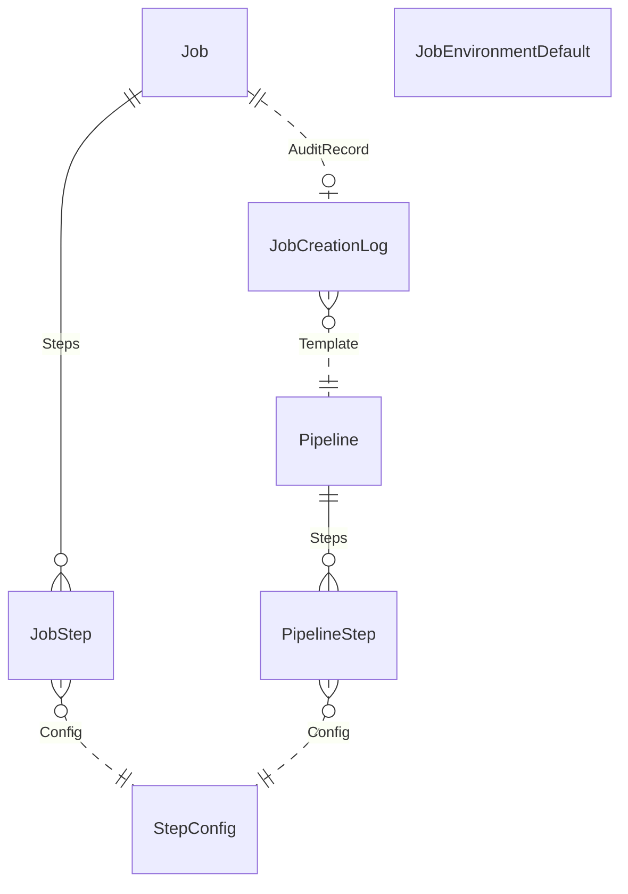

{/* Generated by `modelith render`. Do not edit by hand; edit the .modelith.yaml source and re-render. */}

# SpikesortingLabHub job submission

How a researcher's reusable Pipeline (pipeline_factory) becomes a queued Job (submit_jobs, job_queue) that a worker fetches. Derived only from the models and helper functions in the three Django apps.

## Glossary

- **`AuditRecord`** — Role of the log entry that records one job submission.
- **`Config`** — Role of the StepConfig a step uses.
- **`Fingerprint`** — SHA-256 hash of a config block's JSON (sorted keys). It is the StepConfig primary key, so identical configs are stored once.
- **`Recording`** — The root step of every Job. Its StepConfig hash is supplied at submission and is the dependency root for the other steps.
- **`Researcher`** — Person who creates a Pipeline and submits a job through the sorting wizard.
- **`Steps`** — Role of the ordered step rows that make up a Pipeline or a Job.
- **`Template`** — Role of the Pipeline a job was submitted from.
- **`Worker`** — Process that calls get_next_job_id to pick up the oldest pending Job.

## Enums

### `JobCreationStatus`

Outcome of a job creation attempt recorded in the audit log.

| Value | Definition |
| --- | --- |
| `pending` |  |
| `success` |  |
| `failed` |  |

### `JobStatus`

Lifecycle state of a Job in the queue.

| Value | Definition |
| --- | --- |
| `pending` | Created and waiting; the only state a worker will pick up. |
| `fetched` | Claimed by a worker via get_next_job_id. |
| `running` |  |
| `completed` |  |
| `failed` |  |
| `canceled` |  |

### `JobStepStatus`

Lifecycle state of a single JobStep.

| Value | Definition |
| --- | --- |
| `pending` |  |
| `running` |  |
| `completed` |  |
| `failed` |  |

## Entities

### `Job`

One submitted unit of work in the queue, with its environment configuration and a status. It is a concrete run request, not a template. Lives in job_queue.

**Relationships**

- `JobStep` — 1:n — owned — `Steps` — The steps to execute. Deleting a Job cascades to its steps.
- `JobCreationLog` — 1:0..1 — referenced — `AuditRecord` — Audit record of the submission.

**Attributes**

| Name | Type | Description |
| --- | --- | --- |
| `job_id` | string | UUID primary key. |
| `job_env_config` | json | Environment settings (base directory, job_kwargs, log level, REDIRECT paths). |
| `status` | JobStatus |  |
| `created_at` | timestamp |  |

**Actions**

- `create_a_job` — actor `Researcher`; preserves job-needs-steps, job-step-config-exists, job-step-identifiers-unique
- `get_next_job_id` — actor `Worker`; preserves queue-is-fifo

**Invariants**

- **job-needs-steps** — A `Job` is created with at least one `JobStep`, and the `Job` and its steps are created together or not at all.
- **queue-is-fifo** — A `Worker` receives the oldest pending `Job`, and that `Job` becomes fetched so no other `Worker` gets it.

### `JobCreationLog`

Audit record of one job submission through the sorting wizard: which pipeline, the submitted recording config and environment preset, and the outcome. It keeps the pipeline id as a plain number, not a link. Lives in submit_jobs.

**Relationships**

- `Pipeline` — n:1 — referenced — `Template` — The pipeline selected for the job. Stored as a plain pipeline_id integer, not a database foreign key.

**Attributes**

| Name | Type | Description |
| --- | --- | --- |
| `pipeline_id` | integer |  |
| `recording_config` | json |  |
| `job_env_preset` | json |  |
| `status` | JobCreationStatus |  |
| `error_message` | string | Set only when status is failed. |
| `created_at` | timestamp |  |

**Invariants**

- **log-job-null-on-failure** — A `JobCreationLog` has no `Job` when job creation itself failed.

### `JobEnvironmentDefault`

Tunable default job environment values (worker limits, log paths) for a named environment, editable without a deploy. When no row exists for the requested environment, hardcoded defaults are used. Lives in submit_jobs.

**Attributes**

| Name | Type | Description |
| --- | --- | --- |
| `environment` | string | Unique name; default is the standard environment. |
| `n_jobs` | integer |  |
| `total_memory` | string |  |

**Actions**

- `build_job_env_config` — actor `Researcher`

**Invariants**

- **environment-name-unique** — Each `JobEnvironmentDefault` has a distinct environment name.

### `JobStep`

One step of a Job: a copy of a PipelineStep's function and dependencies, bound to a StepConfig, with its own status. Dependencies are by identifier, which equals the StepConfig hash.

**Relationships**

- `StepConfig` — n:1 — referenced — `Config` — The configuration this step runs with.

**Attributes**

| Name | Type | Description |
| --- | --- | --- |
| `identifier` | string | Step id within the job; set to the StepConfig hash. |
| `function` | string |  |
| `depends_on` | json | Identifiers of steps this step depends on. |
| `status` | JobStepStatus |  |

**Invariants**

- **job-step-config-exists** — Every `JobStep` refers to a `StepConfig` that already exists when the `Job` is created.
- **job-step-identifiers-unique** — Within one `Job`, no two `JobStep` share an identifier, so two steps with identical config blocks are rejected.

### `Pipeline`

A named, reusable template made of ordered PipelineSteps, created by a Researcher. It is not a run: submitting a job reads it but does not change it. Lives in pipeline_factory.

**Relationships**

- `PipelineStep` — 1:n — owned — `Steps` — Ordered steps of the template. Deleting a Pipeline cascades to its steps; order is by pipeline_step_id.

**Attributes**

| Name | Type | Description |
| --- | --- | --- |
| `pipeline_id` | integer |  |
| `description` | string |  |
| `created_at` | timestamp |  |

**Actions**

- `create` — actor `Researcher`

**Invariants**

- **pipeline-steps-ordered** — A `Pipeline` yields its steps in ascending pipeline_step_id order, and a job built from it keeps that order after the `Recording` step.

### `PipelineStep`

One step of a Pipeline. It holds no configuration itself; it points at a StepConfig and lists the config hashes of the steps it depends on.

**Relationships**

- `StepConfig` — n:1 — referenced — `Config` — The configuration this step uses.

**Attributes**

| Name | Type | Description |
| --- | --- | --- |
| `pipeline_step_id` | integer |  |
| `depends_on` | json | List of config_block_hash values of prerequisite steps. |

**Invariants**

- **pipeline-step-has-pipeline** — A `PipelineStep` belongs to exactly one `Pipeline` and is deleted with it.

### `StepConfig`

A unique configuration block for one kind of step, identified by the fingerprint of its JSON. It is shared and never copied: both pipeline steps and job steps point at it. Lives in job_queue.

**Attributes**

| Name | Type | Description |
| --- | --- | --- |
| `config_block_hash` | string | Primary key; the `Fingerprint` of config_block. |
| `config_block` | json | The step's configuration. Unique across all StepConfigs. |
| `function` | string | Step function name, e.g. recording, sorting, analyzer. |

**Actions**

- `get_or_create_step_configs` — actor `Researcher`; preserves stepconfig-hash-is-content

**Invariants**

- **stepconfig-hash-is-content** — A `StepConfig` key is the fingerprint of its config block, so identical config blocks map to one `StepConfig`.

## Relationships

## Scenarios

### Submit a job from a pipeline

Shows how a Pipeline template becomes a queued Job.

**Actors:** Researcher, Worker

**Steps**

1. The `Researcher` picks a `Pipeline` and supplies a recording config in the wizard.
2. The `Recording` config is stored as a `StepConfig`; its `Fingerprint` is the recording identifier.
3. build_job_steps_from_pipeline puts a recording step first, then one entry per `PipelineStep` using that step's `StepConfig` hash and `depends_on`.
4. The placeholders _RECORDING_ and recording in dependencies are replaced with the recording identifier.
5. build_job_env_config reads the `JobEnvironmentDefault` for the chosen environment.
6. create_a_job creates a pending `Job` and one `JobStep` per entry.
7. A `JobCreationLog` records the outcome.
8. A `Worker` calls get_next_job_id and receives the oldest pending `Job`, which is marked fetched.

**Invariants touched**

- **job-needs-steps** — A `Job` is created with at least one `JobStep`, and the `Job` and its steps are created together or not at all.
- **job-step-config-exists** — Every `JobStep` refers to a `StepConfig` that already exists when the `Job` is created.
- **queue-is-fifo** — A `Worker` receives the oldest pending `Job`, and that `Job` becomes fetched so no other `Worker` gets it.

### Pipeline with two identical steps

**Actors:** Researcher

**Steps**

1. Two `PipelineStep` point at the same `StepConfig`.
2. create_a_job finds a duplicate identifier and raises an error.
3. The `JobCreationLog` ends with status failed and an error message.

**Invariants touched**

- **job-step-identifiers-unique** — Within one `Job`, no two `JobStep` share an identifier, so two steps with identical config blocks are rejected.
- **log-job-null-on-failure** — A `JobCreationLog` has no `Job` when job creation itself failed.

